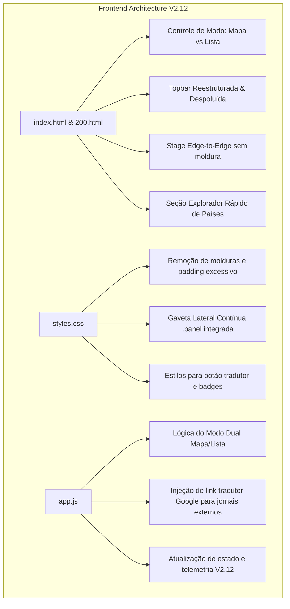

# Plano de Execução: Rodando o Mundo V2.12 (ROM V2.12)

Este plano técnico detalha as alterações no código-fonte do projeto **Rodando o Mundo** para produzir a versão **V2.12**, resolvendo os problemas de sensação compacta/molduras duras, atrito mobile, barreira de idioma e sobrecarga visual.

---

## 1. Goal Description

O objetivo desta intervenção é transformar o **Rodando o Mundo (ROM)** em sua versão **V2.12**, implementando:
1. **Desmolduramento Visual Completo ("Border-less & Edge-to-Edge"):** Remoção de molduras confinantes no mapa e substituição da caixa flutuante de veículos por uma **Gaveta Lateral Contínua (Right Drawer)** no desktop e um **Bottom Sheet Fluido** no mobile.
2. **Modo Dual de Navegação (Mapa Imersivo vs. Explorador por País/Feed):** Permitir alternar instantaneamente entre a navegação no globo e um feed de seleção rápida de países com busca integrada, otimizado para celulares.
3. **Redução da Fricção de Leitura Externa:** Inclusão de atalho de tradução automática via Google Tradutor em 1 clique para jornais estrangeiros e badges explícitas de acesso livre vs. paywall.
4. **Hierarquização e Limpeza da Barra Superior:** Despoluição do topo com foco nas ações primárias (busca, alternador de modo e favoritos).
5. **Geração do Pacote Oficial ROM V2.12:** Empacotamento dos arquivos atualizados em arquivos ZIP prontos para deploy no Netlify, Cloudflare Pages ou GitHub Pages.

---

## 2. User Review Required

> [!IMPORTANT]
> **Compatibilidade SPA e Cloudflare/Netlify:** Todas as alterações preservam a compatibilidade estática do site (HTML/CSS/JS puros, sem bundlers ou frameworks pesados). O arquivo `200.html` e `_redirects` serão sincronizados com as novas regras.

> [!NOTE]
> **Transparência e Responsividade:** A remoção de bordas no mapa aproveita 100% da largura útil da tela (viewport). No desktop com telas ultra-wide, a área geográfica ganha amplitude e o painel de notícias fica elegantemente fixado na lateral direita como uma gaveta nativa, sem cobrir o centro do globo.

---

## 3. Proposed Changes



---

### Componente 1: Estilos Globais e Desmolduramento (`styles.css`)

#### [MODIFY] `styles.css`
* **Layout Edge-to-Edge:**
  * Modificar `.layout` de `padding: var(--space-4) clamp(var(--space-4), 2vw, var(--space-6)) 0` para `padding: 0; max-width: 100%`.
  * Modificar `.map` para remover bordas rígidas (`border: none; border-radius: 0;`), ocupando a altura da tela (`height: calc(100dvh - 4.5rem);`).
* **Gaveta Lateral Contínua (`.panel`):**
  * Eliminar as margens flutuantes `top: var(--space-3); right: var(--space-3); bottom: var(--space-3)`.
  * Configurar como gaveta acoplada à margem direita:
    ```css
    .panel {
      position: absolute;
      top: 0;
      right: 0;
      bottom: 0;
      width: clamp(26rem, 36vw, 38rem);
      border-radius: 0;
      border: none;
      border-left: 1px solid var(--border);
      background: var(--surface);
      backdrop-filter: blur(12px);
      box-shadow: -8px 0 28px rgba(0, 0, 0, 0.12);
      z-index: 50;
      transition: transform 0.35s cubic-bezier(0.16, 1, 0.3, 1);
    }
    ```
* **Controles do Mapa e Abas Mais Leves:**
  * Aliviar `.continents button`: substituir botões encaixotados por abas tipográficas com indicador inferior de 2px.
  * Suavizar botões de zoom e camadas para não criarem sombras escuras pesadas sobre o mapa.
* **Estilos para Ações de Tradução e Badges:**
  * Classes `.btn-translate-outlet` e `.badge-paywall` estilizadas com contraste e harmonia nos modos claro e escuro.

---

### Componente 2: Estrutura da Página Principal (`index.html` e `200.html`)

#### [MODIFY] `index.html` e `200.html`
* **Seletor de Modo na Topbar / Sub-header:**
  * Inserir o alternador de visualização:
    ```html
    <div class="view-mode-toggle" id="view-mode-toggle" role="tablist" aria-label="Modo de visualização">
      <button type="button" class="view-mode-btn is-active" id="btn-mode-map" role="tab" aria-selected="true">
        <svg viewBox="0 0 24 24" width="15" height="15" fill="none" stroke="currentColor" stroke-width="2"><circle cx="12" cy="12" r="10"/><path d="M2 12h20M12 2a15.3 15.3 0 0 1 4 10 15.3 15.3 0 0 1-4-10 15.3 15.3 0 0 1 4-10z"/></svg>
        <span>Mapa</span>
      </button>
      <button type="button" class="view-mode-btn" id="btn-mode-list" role="tab" aria-selected="false">
        <svg viewBox="0 0 24 24" width="15" height="15" fill="none" stroke="currentColor" stroke-width="2"><path d="M8 6h13M8 12h13M8 18h13M3 6h.01M3 12h.01M3 18h.01"/></svg>
        <span>Feed por País</span>
      </button>
    </div>
    ```
* **Seção de Feed / Lista Alternativa (`#quick-country-view`):**
  * Criar seção acessível com busca direta, agrupamento por continente e chips de atalho rápido para países mais visitados.
* **Despoluição do Topbar:**
  * Manter na barra principal: Marca, Alternador de Modo, Campo de Busca Instantânea, Favoritos e Botão Tema.
  * Agrupar links secundários institucionais no menu suspenso `+ Mais`.

---

### Componente 3: Lógica e Interações (`app.js`)

#### [MODIFY] `app.js`
* **Gerenciador de Modo (Mapa vs. Lista):**
  * Alternar entre a visualização `#map-wrap-section` e `#quick-country-view` sem recarregar a página e sincronizando o estado com as rotas.
* **Aprimoramento de Cards de Veículos (`renderOutlets`):**
  * Identificar o idioma do país selecionado (`c.dominantLang` ou idiomas oficiais).
  * Quando o idioma não for o Português, adicionar automaticamente nos links do veículo:
    * Botão secundário: `[ Traduzir 🌐 ]` apontando para `https://translate.google.com/translate?sl=auto&tl=pt&u={encodeURIComponent(outlet.url)}`.
  * Adicionar identificador visual sutil de paywall para grandes jornais por assinatura.
* **Ajuste de Comportamento da Gaveta Lateral:**
  * Assegurar que ao selecionar um país no mapa ou na lista, a gaveta deslize suavemente da direita (desktop) ou suba como Bottom Sheet (mobile).
* **Versão Oficial:**
  * Atualizar o cabeçalho e telemetria para **Rodando o Mundo V2.12**.

---

### Componente 4: Documentação e Pacotes de Deploy

#### [MODIFY] `README.md` e `LEIA-ME.txt`
* Detalhar todas as melhorias e novidades da V2.12.
* Instruções claras de substituição dos arquivos no computador do usuário.

#### [NEW] `rom-v2.12-completo.zip` e `rom-v2.12-apenas-mudancas.zip`
* Empacotamento automático para facilitar a distribuição e o upload.

---

## 4. Verification Plan

### Automated / Syntax Verification
* Validar sintaxe JS em `app.js` via Node.js (`node -c app.js`).
* Validar integridade dos arquivos HTML e CSS.

### Manual Verification
1. **Navegação Desktop:**
   * Abrir o site localmente via servidor HTTP.
   * Verificar se o mapa se estende de ponta a ponta sem bordas apertadas.
   * Clicar no Brasil, EUA, Japão e Alemanha: conferir se a gaveta lateral direita abre como drawer contínuo e sem sobrepor o centro do mapa.
2. **Navegação Mobile (largura <= 768px):**
   * Verificar se o Bottom Sheet desliza confortavelmente.
   * Alternar para o modo "Feed por País" e testar a busca e cliques nos países.
3. **Barreira de Idioma:**
   * Clicar na Alemanha ou Japão e testar se o botão "Traduzir" gera a URL correta com o Google Tradutor.
4. **Verificação de Regressão:**
   * Testar se temas (política, economia, etc.), modo escuro/claro e favoritos continuam funcionando perfeitamente.
